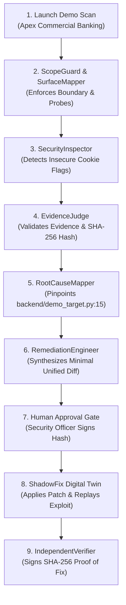

# 🧪 VulnSeal Golden Demo Journey

VulnSeal includes an integrated, isolated demonstration sandbox: **Apex Global Commercial Banking**.

---

## The Golden Workflow (FIND ➔ FIX ➔ PROVE)

---

## Step-by-Step Demo Walkthrough

### 1. Open Demo Portal
Navigate to **Demo Lab** in the VulnSeal sidebar or click **Launch Demo Scan** from the Overview tab.

### 2. Autonomous Scan Execution (FIND)
- **ScopeGuard** validates that the target is an authorized demo sandbox (`/demo-target/*`).
- **SurfaceMapper** maps the banking portal interface and discovers `/demo-target/login`.
- **SecurityInspector** executes deterministic rules and discovers:
  - Missing `Secure` directive on session credential cookie.
  - Missing `HttpOnly` directive.
  - Overly permissive wildcard CORS with credentials.
  - Missing Content Security Policy (CSP).
- **EvidenceJudge** establishes a deterministic SHA-256 hash of the sanitized HTTP transcript.

### 3. Root Cause Mapping & Remediation Synthesis (FIX)
- Select the **Session Cookie Missing Secure Flag** finding.
- Click **Generate Autonomous Fix**:
  - **RootCauseMapper** identifies line 15 of `backend/demo_target.py`.
  - **RemediationEngineer** synthesizes a minimal unified diff patch and automated regression assertion.

### 4. Human Approval Gate
- Inspect the unified diff.
- Enter your email (e.g. `operator@vulnseal.security`).
- Click **Approve & Test in ShadowFix**.
- The cryptographic patch hash is registered in the immutable audit log.

### 5. ShadowFix Replay & Verification (PROVE)
- **ShadowFix** provisions an ephemeral sandbox workspace.
- Applies the approved unified diff patch.
- Executes regression test assertions (0 breaking changes).
- Replays the original exploit request to `/demo-target/login`:
  - Before: `Set-Cookie: session_id=...; Path=/` (Insecure)
  - After: `Set-Cookie: session_id=...; Path=/; HttpOnly; Secure` (Resolved)
- **IndependentVerifier** issues a tamper-evident **SHA-256 Cryptographic Proof of Fix Certificate**.
- View and download the JSON certificate in **Proof Center**.
